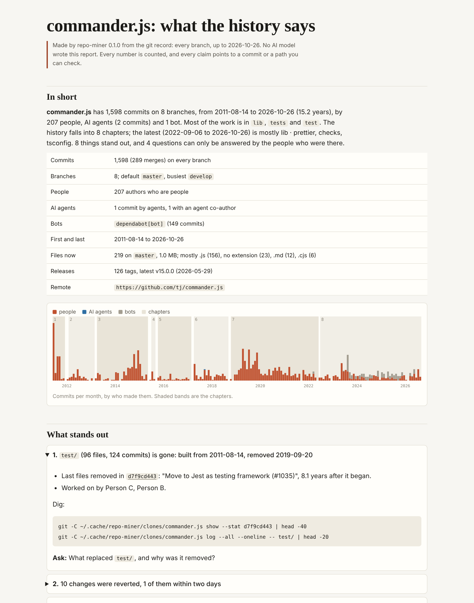

<p align="center"></p>

<h1 align="center">repo-miner</h1>

<p align="center"><b>Understand a repository from its history: what happened, who knows what, and what to ask.</b></p>

<p align="center">
<a href="https://github.com/corgido/repo-miner/actions/workflows/ci.yml"></a>
<a href="LICENSE"></a>


</p>

You have just been handed a repository. The code tells you what it is today. The commit history tells you how it got
there: what was built and torn down, what was reverted two hours later, which branch the real work is on, who wrote the
billing code and stopped committing a year ago. The people hold the reasons. **repo-miner** reads the whole record, every
branch, in seconds, and gives you a report of what stands out, with the command to dig into each finding and the questions
to take to the people who were there.

It is a Claude Code plugin, a skill and a command-line tool. The miner itself is deterministic: no AI model, no tokens, no
network (except to clone a URL you give it), nothing to install beyond Python and git. The same history always gives the
same report.



<sub>The report for [commander.js](examples/commander.js/REPORT.md), made with `--anonymise`. Open [`report.html`](examples/commander.js/report.html) for the page.</sub>

## Try it

**In Claude Code** (the plugin brings the skill: Claude runs the miner, digs into what stands out and hands you an orientation):

```
/plugin marketplace add corgido/repo-miner
/plugin install repo-miner@repo-miner
```

Then ask *"What happened in this repository?"* or *"I've just inherited this, where do I start?"*. Or call it directly
with `/repo-miner:repo-miner https://github.com/owner/repo`.

**From a terminal**, with nothing to install:

```bash
git clone https://github.com/corgido/repo-miner
```

```bash
repo-miner/bin/repo-miner https://github.com/pallets/flask
```

It prints where the report went (`~/repo-miner-reports/flask/` by default). Open `REPORT.md`, or `report.html` in a browser.
To have `repo-miner` on your path, install it with `pipx install git+https://github.com/corgido/repo-miner`.

**Just looking?** `repo-miner demo` builds an invented repository with a messy history, mines it, and checks that every
planted story is found and every planted secret is kept out. It ends `demo: clean`.

## What it finds

Each finding comes with its evidence (commit ids, dates, counts), a `git` command to dig further, and, where the record
cannot say why, the question to ask.

| Finding | What it means for you |
|---|---|
| **The default branch hides the work** | `main` has 3 commits and `develop` has 100: read the wrong one and you read the wrong project |
| **A secret-looking file was committed** | a `.env` or key file is in history, and it held something that looks like a credential (checked, never printed) |
| **Someone went quiet** | a main author of code that still exists stopped committing: the knowledge may have left with them |
| **Knowledge rests on one person** | an area where one author made 80% or more of the commits |
| **Something was built and removed** | a folder that grew for months and is gone, and the commit that removed it; folders that only *moved* are told apart |
| **Changes were reverted** | what was undone, by which commit, and how soon |
| **A file keeps needing fixes** | more fixes than the repository's own baseline |
| **Work never merged** | branches with their own commits, stale or active (release lines and `gh-pages` are recognised and left alone) |
| **Sweeping changes** | one commit that touched a large part of the repository: a reformat, a migration, an import |
| **Silences** | stretches with no commits, long for this record |
| **AI agents arrived** | when agent-written or agent-assisted commits begin, and what share of the work they are |
| **The record is thin** | commit messages that say nothing, so the reasons live somewhere else |

Then the reference sections: the history cut into **chapters** (where it falls silent or changes character), **people**
(who made what, when, where, and who has gone quiet), **areas** (who to ask now about each part), **branches and
releases**, **practices** (CI, code owners, hooks, linters, agent instructions, and which were dropped), and the
repository's own documents, copied with secrets removed.

On real repositories: it found that commander.js moved from Mocha to Jest in 2019, split its changelog and merged it back,
and went ESM-only in 2026; that Flask's `flask/` moved to `src/flask/` and its `requirements/` folder went when it switched
to `uv`; that Django's history falls into the newforms era, the multi-db summer projects, the Python 3 port and the
JSONField years.

## Why history

Tools that map a codebase's imports and calls show you its shape today. They cannot show you the branch where the real
work is, the module that was rewritten three times, the person who wrote it and left, or the approach that was tried and
removed. Those are the questions you have on your first day, and the commit record answers most of them for free. Reading
it with a model costs hundreds of thousands of tokens and gives a different answer each time. repo-miner reads it
mechanically and leaves the judgement to you (or to Claude, working from the report instead of the raw history).

## Options

```text
repo-miner TARGET... [options]       a repository, a folder of repositories, or a git URL

  -o, --out DIR          where the report goes (default ~/repo-miner-reports/<name>)
  --since, --until DATE  read only part of the history
  --anonymise            show people as Person A, Person B, ... (for reports you will share)
  --deny FILE            words that must never appear: names, clients, codenames (one per line)
  --transcripts auto|none|DIR
                         Claude Code session transcripts, found automatically when this machine has them
  --agent, --bot, --human NAME
                         put an author in the right role
  --depth N              clone a huge remote with at most N commits per branch
  --json                 print the run summary as JSON

repo-miner demo          try it on an invented repository
repo-miner scan DIR      leak-scan a report before sharing it (exit 1 on any hit; never prints the hit)
```

## What you get

```text
~/repo-miner-reports/<name>/
  REPORT.md            start here (report.html is the same, as a page with the activity chart)
  findings.json        every finding with its evidence, commands and question
  data/                commits, people, areas, files and branches as TSV; chapters as JSON
  docs/                the repository's own documents, redacted
  practices/           CI, ownership, hooks, linters, agent instructions, with INDEX.md
  briefs/              one brief per chapter, for an agent to write that chapter's story
  run.json             what ran, when, with which options, and the leak-scan result
```

A folder of repositories gives an overview `REPORT.md` that compares them, and one report per repository under `repos/`.

## Privacy

- The miner never runs the repository's code, never checks anything out, and never writes inside the repository.
- Every file it writes passes through one redactor: e-mail addresses, keys and tokens, secret assignments, connection
  strings, private IP addresses, home-directory paths, and your deny list. Then it scans its own output.
- Author e-mail addresses are used only to recognise one person under several names. They are never written.
- `--anonymise` replaces people with Person A, B, ..., and scrubs handles in merge subjects, mentions and co-author trailers.
- Agent transcripts, when read, contribute only what a person typed and what an agent visibly replied. Reasoning, tool
  calls and tool output are never read. The session running the miner is left out.

## How it works

One pass over `git log --all` gives every commit with the files it changed. Authors are sorted into people, AI agents and
bots. Commits are grouped into areas (top-level folders, one level deeper where one folder dominates). The chapters come
from an information measure: the record is cut at its longest silences, then wherever the mix of who works on what changes
by more bits than a BIC-style penalty allows. Findings are fixed rules with thresholds, ranked by severity and size, so the
same record always gives the same list. Details in [docs/HOW-IT-WORKS.md](docs/HOW-IT-WORKS.md); the traps it was built to
avoid in [docs/DESIGN.md](docs/DESIGN.md).

Measured in a 4-core cloud container with the clone already on disk: commander.js (1,598 commits) in 2 seconds, Flask
(5,603) in 5, Express (6,447) in 6, Django (53,039 commits over 21 years) in 66, most of that inside `git log` itself.

## Limits

- It reads git. Pull requests, issues, tickets and chat are not read, and that is often where the reasons are: the
  report says when the record points there (for example, how many commits name a pull request).
- Roles come from author names. An unusual bot counts as a person until you pass `--bot NAME`.
- One person with unrelated names and addresses counts twice unless the repository has a `.mailmap`.
- Renames are read as a removal and an addition; folders that moved are recognised, single renamed files are not followed.

## Development

```bash
python3 -m unittest discover -s tests
```

No dependencies. CI runs the tests and the demo on Linux and macOS with Python 3.9 to 3.13, then mines a public repository
and leak-scans the result. See [CONTRIBUTING.md](CONTRIBUTING.md).

## Where it came from

repo-miner grew out of a set of experimental history miners built with AI coding agents for one person's own body of work.
Each was built independently from the same brief; they agreed on the important parts (an event ledger, privacy first, a
source for every claim) and failed in the same places (the default branch that hides the work, shallow clones, the
reasons that never reach git). This is the cleaned-up, general-purpose result. [docs/DESIGN.md](docs/DESIGN.md) lists the
traps it inherited the fixes for.

## Licence

[MIT](LICENSE)
